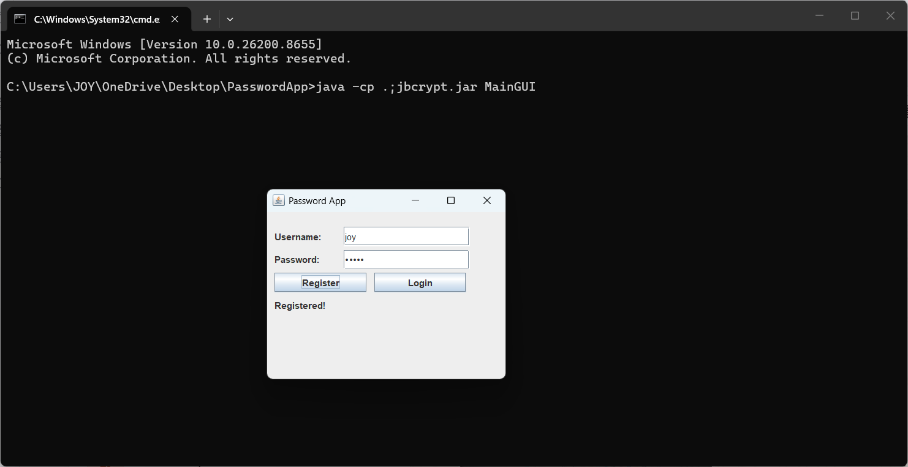
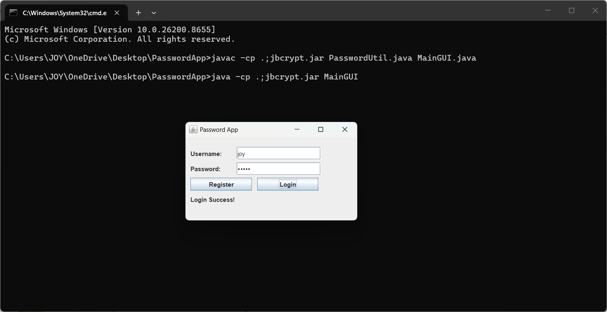
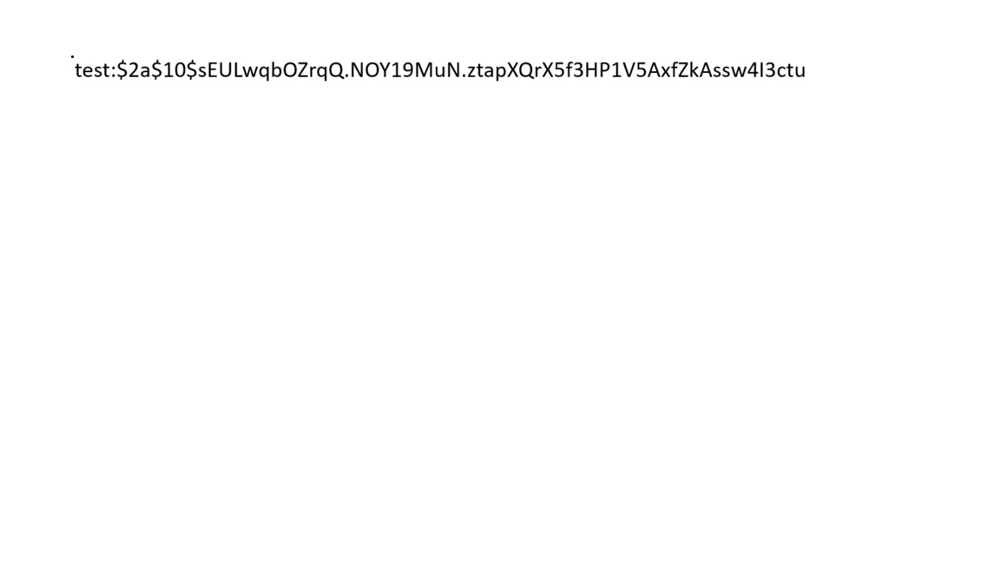

# Password App

A Java desktop authentication demo that demonstrates user registration and login using BCrypt password hashing.

The project includes a Swing graphical interface, a password utility class, and an older console implementation.

## Features

### Graphical Interface

- Username and masked password fields.
- Register and Login buttons.
- Duplicate username checks against loaded and newly registered users.
- Registration and login status messages.
- Loading existing user records from a local `users.txt` file.

### Password Handling

- Password hashing using jBCrypt.
- Random salt generation through `BCrypt.gensalt()`.
- Password verification using `BCrypt.checkpw()`.
- In-memory username-to-hash storage using a Java `HashMap`.

BCrypt hashes passwords; it does not encrypt them for later recovery.

## Technology Stack

| Technology | Purpose |
|---|---|
| Java | Application logic |
| Swing | Desktop graphical interface |
| jBCrypt | Password hashing and verification |
| Java File I/O | Reading and writing user records |
| HashMap | In-memory user storage |

## Repository Files

| File | Description |
|---|---|
| `MainGUI.java` | Swing registration and login interface |
| `PasswordUtil.java` | User loading, saving, registration, and password verification |
| `Main.java` | Console implementation requiring compatibility fixes |
| `jbcrypt.jar` | Included BCrypt library |
| `users.txt` | Existing local user records |
| `1_RunnigProject.jpg.png` | Application screenshot |
| `LoginSuccess.png` | Login screenshot |
| `3_HashedProof.jpg` | Password-hash screenshot |

## Requirements

- A Java Development Kit (JDK).
- `java` and `javac` available in your terminal.
- A desktop environment capable of displaying Swing windows.

The BCrypt dependency is included as `jbcrypt.jar`. Maven and Gradle are not required.

## Getting Started

### 1. Clone the Repository

```bash
git clone https://github.com/JerushaJutike29/Password-App.git
cd Password-App
```

### 2. Compile the Graphical Application

Run these commands from the repository directory.

**Windows — PowerShell or Command Prompt:**

```powershell
javac -cp ".;jbcrypt.jar" PasswordUtil.java MainGUI.java
java -cp ".;jbcrypt.jar" MainGUI
```

**Linux or macOS:**

```bash
javac -cp ".:jbcrypt.jar" PasswordUtil.java MainGUI.java
java -cp ".:jbcrypt.jar" MainGUI
```

The classpath separator is `;` on Windows and `:` on Linux/macOS.

Compile the specified files rather than all Java files, because the current console implementation contains unresolved method calls.

## Using the Application

1. Enter a username and password.
2. Click **Register** to create a user in the current session.
3. Enter the same credentials and click **Login**.
4. The interface displays whether authentication succeeded.

Usernames are case-sensitive.

## How Authentication Works

### Registration

1. Check whether the username already exists in memory.
2. Generate a salt.
3. Hash the password with BCrypt.
4. Store the username and hash in memory.

### Login

1. Find the stored hash for the username.
2. Compare the entered password against that hash using BCrypt.
3. Display the login result.

## File Storage

The utility class reads records from `users.txt` using this format:

```text
username:bcrypt_hash
```

The file path is relative to the directory from which the application is launched.

`PasswordUtil` also includes a `saveUsers()` method. However, the current GUI does not call it after registration. Newly registered users therefore remain available only until the application closes.

Automatic persistence requires calling `saveUsers()` after successful registration and handling write failures appropriately.

## Current Implementation Issues

### Console Version

`Main.java` calls:

```java
PasswordUtil.encrypt(pass)
PasswordUtil.verify(pass, storedHash)
```

These methods do not exist in the current `PasswordUtil.java`. The console version needs to be updated to use compatible hashing and verification logic before it can compile.

### Input Validation

Blank usernames and passwords are not explicitly rejected. Usernames containing `:` can also conflict with the file format.

### Error Handling

- User-file loading errors are silently ignored.
- File-saving errors are printed rather than reported through the interface.
- Invalid BCrypt hashes are not explicitly handled.

## Screenshots

### Application Interface



### Login Result



### Stored Password Hash



## Project Scope

This is an educational authentication demo, not a password manager or a production authentication system.

It does not include password recovery, login rate limiting, account lockout, session management, or a database.

## Possible Improvements

- Fix the console implementation.
- Persist registrations automatically.
- Validate usernames and passwords.
- Improve file-error handling.
- Handle malformed user records safely.
- Move BCrypt operations off the Swing event thread.
- Add automated tests.
- Exclude real user records and generated `.class` files from version control.

## Learning Outcomes

- Building interfaces with Java Swing.
- Handling button events.
- Hashing and verifying passwords with BCrypt.
- Reading and writing local files.
- Managing user records with Java collections.
- Understanding the difference between hashing and encryption.
